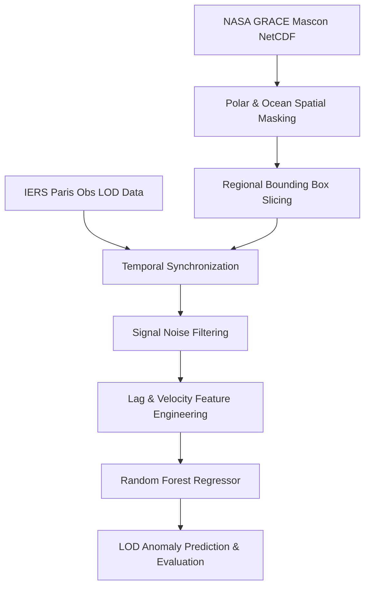

# TURA-GeoSync: Tectonic Mass Transfer & Earth Rotation (LOD) Prediction

[](https://www.python.org/)
[](https://opensource.org/licenses/MIT)
[]()

**TURA-GeoSync** is a geophysical data science framework designed to model and predict variations in Earth's rotation velocity—measured as **Length of Day (LOD)** anomalies—driven by regional continental lithospheric mass redistribution (e.g., tectonic activity in the Himalayas and Tibetan Plateau).

By integrating **NASA GRACE/GRACE-FO satellite mascon data** with **IERS Earth Orientation Parameters (EOP)**, the pipeline isolates solid Earth lithospheric signals and applies Random Forest regression with temporal lag dynamics.

---

## 🌟 Key Features

- **Automated Data Ingestion**:
  - Direct connection to **IERS Paris Observatory** primary mirrors for daily LOD time series.
  - Automated cloud dataset queries from **NASA EarthData CMR API** via `earthaccess`.
- **Memory-Optimized NetCDF Processing**:
  - Employs `xarray` lazy evaluation and spatial chunking (`chunks='auto'`) for efficient memory handling.
  - Filters out polar ice sheet melt noise (Greenland & Antarctica) and ocean mass signals to isolate continental lithosphere dynamics.
- **High-Precision Synchronization**:
  - Temporally aligns high-frequency daily LOD observations with low-frequency monthly GRACE observation anchors.
- **Advanced Signal Processing & Feature Engineering**:
  - Rolling median filtering for high-frequency leap second noise.
  - Moving average windowing for monsoonal hydrological seasonal cycles.
  - Generates temporal lag features (`Mass_Lag1`, `Mass_Lag3`, `Mass_Lag6`) and velocity (first-derivative) dynamics.
- **Machine Learning Modeling**:
  - Chronological time-series split and Random Forest Regressor training.
  - Dual-axis correlation visualization and automated $R^2$ / MSE evaluation metrics.

---

## 🏗️ Repository Architecture

```text
earthquaqe/
├── config.py             # Central project configuration & dynamic relative paths
├── iers_lod.py           # Ingestion module for IERS Length of Day (LOD) time series
├── grace_litosfer.py     # NASA GRACE NetCDF lazy loading & lithospheric spatial masking
├── sync_data.py          # Temporal alignment module (Daily LOD -> Monthly GRACE)
├── correlation_model.py  # Regional spatial slicing & Pearson correlation analysis
├── tura_ai_model.py      # End-to-end Machine Learning (Random Forest) pipeline
├── nasa_downloader.py    # Automated NASA EarthData dataset downloader
├── grace_data/           # Directory for GRACE NetCDF dataset files
├── requirements.txt      # Python dependencies manifest
└── README.md             # Project documentation
```

---

## ⚙️ Installation & Setup

### 1. Prerequisites
Ensure you have **Python 3.9+** installed on your system.

### 2. Clone the Repository
```bash
git clone https://github.com/your-username/tura-geosync.git
cd tura-geosync
```

### 3. Install Dependencies
Install all required libraries specified in `requirements.txt`:
```bash
pip install -r requirements.txt
```

---

## 🚀 Quick Start & Usage

### 1. Run End-to-End AI Pipeline
To execute the complete data ingestion, noise filtering, feature engineering, and Random Forest model training workflow:

```bash
python tura_ai_model.py
```

**Expected Output:**
```text
==================================================
Starting TURA-GeoSync AI Pipeline (Random Forest)
==================================================

[Pipeline Phase 1] Data Ingestion & Regional Extraction...
[GRACE Lithosphere] Loading GRACE mascon dataset...
[IERS LOD] Connecting to IERS primary endpoint...
[Synchronization] Starting temporal alignment phase...
[Pipeline Phase 2] Applying Signal Filtering (Rolling Window Filters)...
[Pipeline Phase 3] Engineering Temporal Lag & Velocity Features...
[Pipeline Phase 4] Training Random Forest Machine Learning Model...
--------------------------------------------------
RANDOM FOREST MODEL PERFORMANCE EVALUATION
R-squared Score (Variance Explained): 0.5635
Mean Squared Error (MSE):           1.213909e-03
--------------------------------------------------
```

### 2. Run Regional Correlation Analysis
To analyze Pearson correlation between Himalayan mass anomalies and Earth rotation velocity:

```bash
python correlation_model.py
```

### 3. Download Latest GRACE Mascon Data
To query and download updated NASA GRACE/GRACE-FO mascon datasets directly into `grace_data/`:

```bash
python nasa_downloader.py
```

---

## 📊 Pipeline Methodology



---

## 🔧 Configuration & Customization

You can customize geographical region bounding boxes, data paths, and ML hyperparameters directly in [`config.py`](config.py):

```python
# Custom Region Definition (Bounding Box: lat_min, lat_max, lon_min, lon_max)
REGIONS = {
    "himalayas": {
        "name": "Himalayas and Tibetan Plateau",
        "lat_min": 25,
        "lat_max": 40,
        "lon_min": 70,
        "lon_max": 100
    }
}

# Machine Learning Hyperparameters
RANDOM_STATE = 42
TEST_SIZE = 0.2
RF_N_ESTIMATORS = 100
```

---

## 📜 Data Sources & Acknowledgments

- **IERS (International Earth Rotation and Reference Systems Service)**: Paris Observatory ([hpiers.obspm.fr](https://hpiers.obspm.fr/iers/eop/eopc04/)) for EOP C04 time-series products.
- **NASA JPL (Jet Propulsion Laboratory)**: GRACE/GRACE-FO Tellus Mascon RL06.3 land gravity anomaly products.

---

## 📄 License

This project is licensed under the MIT License - see the LICENSE file for details.
